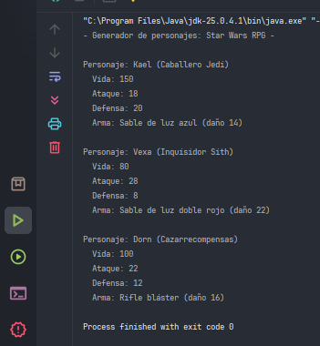

# Ejercicio 05 – Generador de personajes para videojuego de rol (Star Wars)

## Descripción

Un videojuego de rol ambientado en el universo de Star Wars permite elegir entre distintas clases de personaje (Caballero Jedi, Inquisidor Sith y Cazarrecompensas). Cada una tiene estadísticas iniciales (vida, ataque y defensa) y un arma predeterminada propia.

## Objetivos

- Controlar la creación de objetos complejos con configuraciones iniciales distintas.
- Construir el personaje y asignarle automáticamente su arma inicial.
- Evitar bloques condicionales extensos en el cliente: solo se indica el tipo deseado.

## Implementación del patrón Factory Method

| Rol en el patrón | Clase |
|---|---|
| Producto | `GameCharacter` |
| Productos concretos | `JediKnight`, `SithInquisitor`, `BountyHunter` |
| Producto auxiliar | `Weapon` → `Lightsaber`, `DoubleBladedLightsaber`, `BlasterRifle` |
| Creador (abstracto) | `CharacterCreator` (métodos de fábrica `instantiateCharacter()` y `createWeapon()`) |
| Creadores concretos | `JediKnightCreator`, `SithInquisitorCreator`, `BountyHunterCreator` |
| Selección por tipo | `CharacterType` + `CharacterCreatorRegistry` |
| Cliente | `Main` |

Es la variante **parametrizada**: el cliente pide `registry.create(CharacterType.SITH_INQUISITOR, "Vexa")` y el registro delega en el creador correcto mediante un mapa, sin `if` ni `switch`. Los atributos iniciales viven en el constructor de cada producto concreto.

| Clase | Vida | Ataque | Defensa | Arma inicial |
|---|---|---|---|---|
| Caballero Jedi | 150 | 18 | 20 | Sable de luz azul |
| Inquisidor Sith | 80 | 28 | 8 | Sable de luz doble rojo |
| Cazarrecompensas | 100 | 22 | 12 | Rifle bláster |

## Propósito de la clase

| Clase | Propósito |
|---|---|
| `GameCharacter` | Guarda nombre, clase, vida, ataque, defensa y arma; muestra sus estadísticas. |
| `JediKnight` / `SithInquisitor` / `BountyHunter` | Definen las estadísticas iniciales de cada clase. |
| `Weapon`, `Lightsaber`, `DoubleBladedLightsaber`, `BlasterRifle` | Armas iniciales con su nombre y daño. |
| `CharacterCreator` | Define los métodos de fábrica y `createCharacter()`, que arma el personaje y lo equipa. |
| `JediKnightCreator` / `SithInquisitorCreator` / `BountyHunterCreator` | Crean el personaje y el arma de su clase. |
| `CharacterType` | Enumeración con los tipos disponibles. |
| `CharacterCreatorRegistry` | Recibe el tipo solicitado y delega en el creador correspondiente. |
| `Main` | Crea un personaje de cada clase y muestra sus estadísticas. |

## Concepto clave

La configuración inicial de cada clase está **encapsulada en su creador y su producto**, no en el cliente. El método de fábrica construye el personaje y, dentro del mismo proceso, crea el arma correspondiente, de modo que nunca queda un personaje sin equipar.

## Resultado

## Conclusión

Factory Method permite crear jerarquías de objetos con configuraciones diferenciadas de forma ordenada. Agregar una nueva clase (por ejemplo, Contrabandista) implica crear su personaje, su arma y su creador, y registrarlo, sin modificar el cliente.
